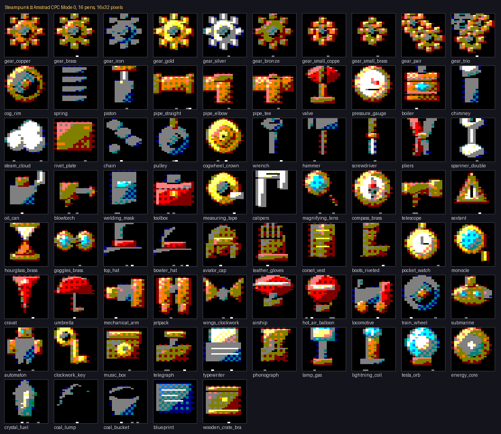
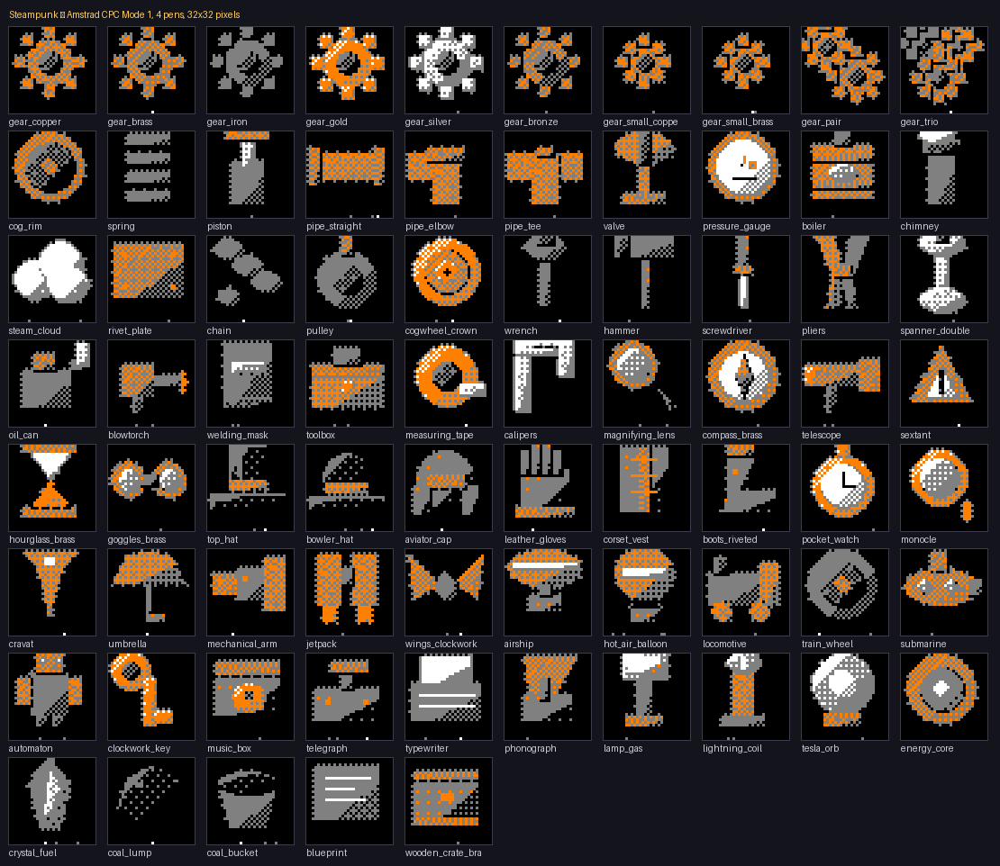

# Steampunk — 75 εικονίδια για Amstrad CPC

Το πακέτο `steampunk.png` (75 εικονίδια 32×32) μετατρεμμένο σε **Mode 0** και
**Mode 1** του Amstrad CPC, με παλέτες από τα 27 χρώματα του firmware.



*Mode 0: 16 pens, 16×32 pixels. Σχεδιασμένο με αναλογία 2:1, όπως βγαίνει στην οθόνη.*



*Mode 1: 4 pens, 32×32 pixels.*

## Οι δύο γεωμετρίες

| | Mode 1 | Mode 0 |
|---|---|---|
| οθόνη | 320×200, 4 pens | 160×200, 16 pens |
| αναλογία pixel | 1:1 | **2:1** |
| εικονίδιο | **32×32** pixels | **16×32** pixels |
| στην οθόνη | 32×32 μονάδες | 32×32 μονάδες |
| pixels ανά byte | 4 | 2 |
| bytes ανά γραμμή | 8 | 8 |
| **bytes ανά εικονίδιο** | **256** | **256** |
| σύνολο 75 εικονιδίων | 19.200 | 19.200 |

Το Mode 0 είναι **16 pixels φαρδύ και όχι 32**: το pixel του είναι διπλάσια
φαρδύ από ψηλό, οπότε 16 × 2 = 32 μονάδες, όσο και οι 32 γραμμές. Με 32 pixels
το εικονίδιο θα έβγαινε **διπλά φαρδύ** στην οθόνη.

Η συμμετρία είναι βολική: και οι δύο εκδόσεις πιάνουν **ακριβώς τα ίδια bytes**
και έχουν **ίδιο μέγεθος στην οθόνη**. Αλλάζει μόνο τι θυσιάζεις — το Mode 1
δίνει διπλή οριζόντια λεπτομέρεια με 4 χρώματα, το Mode 0 δίνει 16 χρώματα με
τη μισή λεπτομέρεια.

> Αν θέλεις όλη τη λεπτομέρεια **και** τα 16 χρώματα, το εικονίδιο πρέπει να
> γίνει 32×64 pixels σε Mode 0 — τετράγωνο αλλά διπλάσιο, 1.024 bytes το
> καθένα και 76.800 συνολικά. Δεν παράγεται εδώ· αλλάζει μία γραμμή στη
> γεννήτρια αν το χρειαστείς.

## Τι περιέχει

| Αρχείο | Περιεχόμενο |
|---|---|
| `icons_mode0.bin` / `.asm` | 75 εικονίδια σε bytes Mode 0, έτοιμα για `incbin` |
| `icons_mode1.bin` / `.asm` | το ίδιο για Mode 1 |
| `steampunk_mode0_sheet.png` | όλα σε ένα PNG, **αυθεντικά pixels** Mode 0 (160×256) |
| `steampunk_mode1_sheet.png` | το ίδιο για Mode 1 (320×256) |
| `preview_mode0.png` / `preview_mode1.png` | κατάλογοι με ονόματα, σε σωστή αναλογία |
| `palette_mode0.gpl` / `palette_mode1.gpl` | οι παλέτες για GIMP/Aseprite, με firmware numbers |
| `icons.json` | ονόματα, παλέτες, μεγέθη, μνήμη |
| `steampunk.png` | η πηγή |
| `src/` | η γεννήτρια — `python3 src/make_icons.py` τα ξαναφτιάχνει |

Κάθε `.asm` έχει σταθερά ανά εικονίδιο (`ico_gear_copper equ 0`, …), οπότε
`διεύθυνση = icons_gfx + ico_κάτι * ICON_SZ`. Το **pen 0 είναι το φόντο**, άρα
μάσκα βγαίνει με ένα πέρασμα αν τα θες ως sprites.

## Η πηγή είναι contact sheet, όχι τα αυθεντικά

Το `steampunk.png` είναι **προεπισκόπηση**: τα εικονίδια είναι ζωγραφισμένα
**×3,5** μέσα σε κάρτες 141×141 με ετικέτες από κάτω. Η μεγέθυνση είναι
πλησιέστερου γείτονα, οπότε δειγματοληψία στο **κέντρο** κάθε κελιού
επιστρέφει ακριβώς το αυθεντικό pixel.

Ότι όντως το επιστρέφει δεν το υποθέτουμε — το **μετράμε**: μετά την εξαγωγή,
κάθε εικονίδιο βγάζει ώς 37 διαφορετικά χρώματα. Σε θολωμένη ή κακώς
ευθυγραμμισμένη πηγή θα έβγαζε εκατοντάδες, και η γεννήτρια σταματάει.

Το βήμα ×3,5 βρέθηκε με **αυτοσυσχέτιση** του προφίλ κλίσης: η κορυφή είναι
στο lag 7 με δευτερεύουσες στο 3 και στο 4, δηλαδή ακριβώς το μοτίβο
«3, 4, 3, 4…» που δίνει μη ακέραια μεγέθυνση.

Αν βρεθούν τα αυθεντικά 32×32 PNG, η μετατροπή θα είναι λίγο καθαρότερη —
άλλαξε μόνο το `extract()`.

## Οι παλέτες

**Επιλεγμένες, όχι υπολογισμένες.**

Η γεννήτρια έχει και αυτόματο διαλέκτη (άπληστη επιλογή + τοπική αναζήτηση με
ανταλλαγές, πάνω στα 27 χρώματα του firmware). Βρίσκει παλέτα με **ελάχιστα
μικρότερο** σφάλμα — 35,6 έναντι 36,2 στα 255 για το Mode 0 — αλλά ξοδεύει
τέσσερα pens σε μωβ, πράσινο και παστέλ μπλε που μαζί καλύπτουν **0,9%** των
pixels. Αυτά τα λίγα pixels πέφτουν σκόρπια πάνω στα περιγράμματα σαν σκόνη.

Με 239 χρώματα πηγής και κύβο 27 χρωμάτων, η ομοιόμορφη κατανομή **είναι**
αριθμητικά βέλτιστη και οπτικά χειρότερη. Ο διαλέκτης μένει στον κώδικα για να
μετράει πόσο μακριά είμαστε από το βέλτιστο, όχι για να αποφασίζει.

**Mode 0** — μαύρο, μπλε νύχτας, μπορντό, λαδί, σκούρο πράσινο, σκούρο κυανό,
γκρι, πορτοκαλί, έντονο κόκκινο, έντονο κίτρινο, έντονο πράσινο, έντονο κυανό,
γαλάζιο, ροζ, χλωμό κίτρινο, λευκό. Δηλαδή: χαλκός, μπρούντζος, σίδερο, γυαλί,
κρύσταλλο, και οι ανταύγειές τους.

**Mode 1** — μαύρο, **πορτοκαλί**, γκρι, λευκό. Με τέσσερα pens πρέπει να
διαλέξεις τι ξεχωρίζει: ζεστό μέταλλο από κρύο μέταλλο από ανταύγεια. Η
αυτόματη έδινε μαύρο/μπορντό/γκρι/χλωμό χρυσό με σφάλμα 42,4 έναντι 44,6,
αλλά έβγαζε τα πάντα σκουριά — χωρίς πορτοκαλί δεν υπάρχει μπρούντζος, και ο
μπρούντζος είναι το μισό πακέτο.

## Dithering

Ordered dither ανάμεσα στις **δύο κοντινότερες** πένες, με το κελί να είναι
**1 pixel × 2 γραμμές στο Mode 0** (ώστε να βγαίνει τετράγωνο στην οθόνη και
να μην τρεμοπαίζει) και 4×4 Bayer στο Mode 1, όπου τα pixels είναι ήδη
τετράγωνα.

Μπαίνει **μόνο στη μεσαία ζώνη**: αν το χρώμα της πηγής πέφτει κοντά σε μία
πένα, παίρνει αυτήν σκέτη. Χωρίς αυτόν τον περιορισμό ο dither έπιανε και τα
περιγράμματα και τις μονοπίξελες ανταύγειες — τα εικονίδια γίνονταν σκακιέρα
και η σιλουέτα τους χανόταν. Σε 32×32 το μάτι δεν «σβήνει» τον θόρυβο όπως σε
μια μεγάλη εικόνα. Έτσι ο dither αγγίζει **10,8%** των pixels στο Mode 0 και
**6,5%** στο Mode 1 — μόνο εκεί που υπάρχει πραγματικός ενδιάμεσος τόνος.

## Η μορφή στη μνήμη

Γραμμικά, γραμμή-γραμμή, **όχι** στη διάταξη της μνήμης οθόνης. Αδιαφανή.

Και στους δύο τρόπους το **bit 0 της πένας πάει στο ΠΑΝΩ bit του byte**:

```
Mode 0   αριστερό pixel: bit0->b7  bit1->b3  bit2->b5  bit3->b1
         δεξί     pixel: bit0->b6  bit1->b2  bit2->b4  bit3->b0
Mode 1   pixel i:        bit0->b(7-i)        bit1->b(3-i)
```

Γράφεται εύκολα ανάποδα, γι' αυτό το `src/cpcimg.py` κρατάει τον αντίστροφο
δίπλα στον κωδικοποιητή με ισχυρισμό που τρέχει σε κάθε import και τους δένει
σε **όλες** τις δυνατές τιμές (256 ζεύγη στο Mode 0, 256 τετράδες στο Mode 1).
Μετά το χτίσιμο, ολόκληρο το blob αποκωδικοποιείται πίσω και συγκρίνεται.
