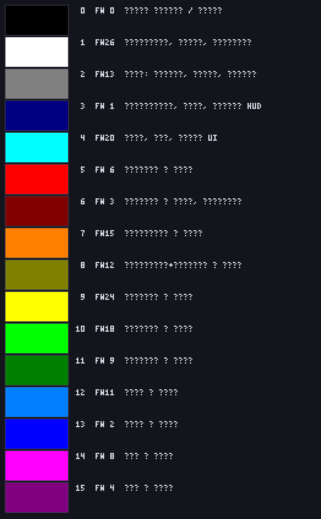
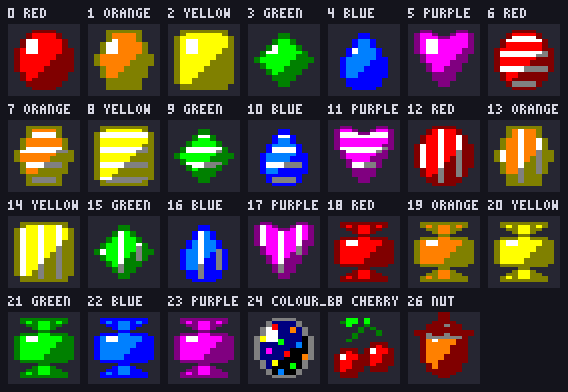
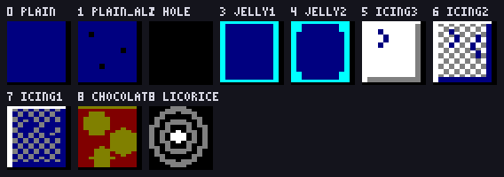
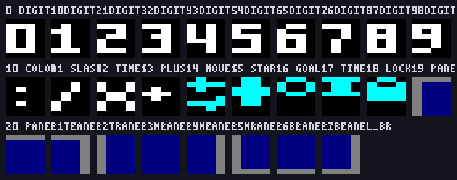

# Sugar Byte — γραφικά match-3 για Amstrad CPC Mode 0

Πλήρες γραφικό πακέτο για παιχνίδι τριάδων τύπου Candy Crush, φτιαγμένο για
**Mode 0** του Amstrad CPC: 160×200 pixels, 16 pens, pixels με αναλογία 2:1.

Το παιχνίδι ζει στο [SugarByteCPC](https://github.com/vaspervnp/SugarByteCPC) —
εδώ είναι μόνο η πηγή των γραφικών. Όλα παράγονται από τη γεννήτρια στο `src/`
και υπάρχουν και ως `.aseprite` για πείραγμα με το χέρι.


*Ολόκληρη η οθόνη 160×200, σχεδιασμένη με pixels 2:1. Αυθεντικά pixels:
[`mockup_screen.png`](mockup_screen.png).*

## Τα μεγέθη

Ένα **κελί ταμπλό** είναι **12 pixels φάρδος × 24 γραμμές** — τετράγωνο στην
οθόνη (24×24 «μονάδες»), 6 bytes τη γραμμή. Το ταμπλό είναι **8×8 κελιά**:
96×192 pixels, και μένουν **64 pixels δεξιά για το HUD**.

Ένα **κελί HUD** είναι **4×8** (8×8 μονάδες) — ίδιο κελί με τη γραμματοσειρά
4×8 του `planetbase/`, άρα τα γράμματα από εκείνη μπαίνουν δίπλα σε αυτά τα
ψηφία χωρίς καμία μετατροπή.

Τα candies και οι επικαλύψεις έχουν **μάσκα** (pen 0 διάφανο)· τα κελιά του
ταμπλό και του HUD είναι **αδιαφανή**. Έτσι το ίδιο candy πατάει πάνω σε σκέτο
κελί, σε ζελέ ή σε σοκολάτα χωρίς αντίγραφα: αλλιώς τα 27 candies θα ήθελαν
μία έκδοση για κάθε φόντο.

## Τι περιέχει

| Αρχείο | Περιεχόμενο |
|---|---|
| `candy_cpc_mode0.*` | 27 candies 12×24 με μάσκα: 6 χρώματα × 4 μορφές, βόμβα, 2 υλικά |
| `cells_cpc_mode0.*` | 10 κελιά ταμπλό 12×24 αδιαφανή: φόντο, ζελέ, γλάσο, εμπόδια |
| `overlay_cpc_mode0.*` | 14 επικαλύψεις 12×24 με μάσκα: δείκτης, κλουβί, μαρμελάδα, εφέ |
| `hud_cpc_mode0.*` | 28 κελιά HUD 4×8 αδιαφανή: ψηφία, σύμβολα, εικονίδια, πλαίσιο |
| `sprites.bin` / `sprites.asm` | και τα τέσσερα σετ σε bytes Mode 0, έτοιμα για `incbin` |
| `sprites_map.txt` | πού κάθεται κάθε καρέ μέσα στο `sprites.bin` |
| `palette.gpl` | η παλέτα για GIMP/Aseprite, με τα firmware numbers |
| `manifest.json` | σύνοψη: παλέτα, σετ, μεγέθη, διάταξη ταμπλό, μνήμη |
| `mockup_screen*.png` | μία πλήρης οθόνη 160×200 |
| `preview_*.png` | κατάλογοι με δείκτες, σε αναλογία 2:1 |
| `src/` | η γεννήτρια — `python3 src/make_all.py` τα ξαναφτιάχνει όλα |

## Η παλέτα



Δεκαέξι pens από τα 27 του firmware. Τα **τέσσερα πρώτα είναι καρφωμένα** και
τα **δώδεκα υπόλοιπα είναι τα έξι χρώματα των candies**, βάση + σκιά:

| | pen | FW | χρώμα | ρόλος |
|---|---|---|---|---|
| | 0 | 0 | `#000000` | φόντο ταμπλό **και** μάσκα των sprites |
| | 1 | 26 | `#FFFFFF` | ανταύγεια, ρίγες, γράμματα |
| | 2 | 13 | `#808080` | γκρι: πλέγμα, γλάσο, χρώμια |
| | 3 | 1 | `#000080` | περίγραμμα, σκιά, ταμπλό HUD |
| | 4 | 20 | `#00FFFF` | ζελέ, εφέ, τόνος UI |
| κόκκινο | 5 / 6 | 6 / 3 | `#FF0000` / `#800000` | μπαλάκι |
| πορτοκαλί | 7 / 8 | 15 / 12 | `#FF8000` / `#808000` | εξάγωνο |
| κίτρινο | 9 / 8 | 24 / 12 | `#FFFF00` / `#808000` | τετράγωνο |
| πράσινο | 10 / 11 | 18 / 9 | `#00FF00` / `#008000` | ρόμβος |
| μπλε | 12 / 13 | 11 / 2 | `#0080FF` / `#0000FF` | δάκρυ |
| μωβ | 14 / 15 | 8 / 4 | `#FF00FF` / `#800080` | καρδιά |

Το **πορτοκαλί και το κίτρινο μοιράζονται τη σκιά τους** (pen 8): δεν περίσσευε
δέκατο έκτο pen. Γι' αυτό ο κώδικας διαβάζει τον πίνακα `candy_pens` (6 ζεύγη
= 12 bytes) και δεν υπολογίζει `5 + 2 × χρώμα`.

Το pen 0 είναι **ταυτόχρονα το φόντο και η μάσκα**, και αυτό είναι επίτηδες:
ένα sprite με μάσκα πάνω στο μαύρο ταμπλό δείχνει μαύρο εκεί που είναι
διάφανο, δηλαδή ακριβώς ό,τι πρέπει. Γι' αυτό το **περίγραμμα κάθε candy δεν
είναι μαύρο αλλά η σκιά του ίδιου του candy**.

## Τα candies



Κάθε χρώμα έχει **δική του σιλουέτα**, όχι μόνο δικό του χρώμα: μπαλάκι,
εξάγωνο, τετράγωνο, ρόμβος, δάκρυ, καρδιά. Σε Mode 0 δύο διπλανά pens
μπερδεύονται εύκολα σε μικρή οθόνη ή σε ασπρόμαυρη, και το σχήμα είναι το
μόνο που κρατάει.

Τέσσερις μορφές ανά χρώμα:

- **`plain`** — το κανονικό.
- **`striped_h`** — ριγέ οριζόντια, καθαρίζει γραμμή.
- **`striped_v`** — ριγέ κάθετα, καθαρίζει κολόνα.
- **`wrapped`** — περιτύλιγμα, σκάει 3×3. **Ένα σχήμα για όλα τα χρώματα**, με
  στριφτές άκρες πάνω και κάτω. Οι άκρες πάνε στον κάθετο άξονα επειδή το Mode 0
  έχει διπλή ανάλυση εκεί: ίδιο μέγεθος στην οθόνη, διπλάσια pixels για να φανεί
  το χωνί.

Συν τη **βόμβα χρώματος** (δεν έχει χρώμα η ίδια — σώμα στο μπλε της νύχτας με
τρούφες σε κάθε χρώμα) και δύο **υλικά**, κεράσι και φουντούκι, για τις πίστες
«κατέβασέ τα ώς κάτω».

Τα ριγέ ζωγραφίζονται **χωρίς ανταύγεια**: η λευκή βούλα κολλούσε στις ρίγες και
γινόταν μπάλωμα. Οι ρίγες παίρνουν κι αυτές φως — λευκές στο φωτεινό μισό, γκρι
στο σκιερό.

## Τα κελιά του ταμπλό



`plain` / `plain_alt` σκακιέρα (η δεύτερη με τρεις μόνο βούλες — το ταμπλό δεν
πρέπει να τραβάει το μάτι από τα candies), `hole` έξω από το ταμπλό,
`jelly1` / `jelly2` ζελέ, `icing1..3` γλάσο, `chocolate`, `licorice`.

Το **ζελέ σημαδεύεται στο περίγραμμα** του κελιού, όχι στο γέμισμα: το γέμισμα
το σκεπάζει το candy από πάνω και δεν θα φαινόταν ποτέ. Το **γλάσο μετριέται
και από τη φωτεινότητα και από τις ρωγμές** — μόνο οι ρωγμές ήταν πολύ λίγο
σε 12×24 pixels.

Το πλέγμα μπαίνει στη **δεξιά κολόνα και στην κάτω γραμμή** κάθε κελιού, ώστε
δύο γειτονικά κελιά να δίνουν μία γραμμή και όχι δύο.

## Επικαλύψεις και εφέ


`cursor1/2` ο δείκτης που αναβοσβήνει, `cage` το κλουβί γλυκόριζας, `marmalade`
το διάφανο κέλυφος, `pop1..4` η έκρηξη, `beam_h/v` οι δέσμες των ριγέ,
`star1/2` το αστέρι των πόντων.

Η μαρμελάδα είναι **σκακιέρα 1 pixel × 2 γραμμές**: το Mode 0 δεν έχει
«μισό-διάφανο», και ο dither 1×2 είναι ο μόνος που δεν τρεμοπαίζει.

## Το HUD



Ψηφία 0-9, τα σύμβολα `:` `/` `×` `+`, πέντε εικονίδια (πόντοι, κινήσεις,
στόχος, χρόνος, κλειδωμένο) και τα 9 κομμάτια του πλαισίου. Οι στόχοι της
πίστας δείχνονται με τα **ίδια τα candies 12×24** — δεν χρειάζονται δικά τους
εικονίδια.

## Η μορφή στη μνήμη

Γραμμικά, γραμμή-γραμμή, **όχι** στη διάταξη της μνήμης οθόνης.

Με μάσκα: `mask, data, mask, data…` ανά γραμμή. Οι σταθερές `_W` του
`sprites.asm` δίνουν bytes **ΔΕΔΟΜΕΝΩΝ** ανά γραμμή — σε sprite με μάσκα η
γραμμή πιάνει **2×** αυτό.

| σετ | κελί | καρέ | bytes/καρέ | σύνολο |
|---|---|---|---|---|
| `candy` | 12×24 με μάσκα | 27 | 288 | 7.776 |
| `cells` | 12×24 αδιαφανές | 10 | 144 | 1.440 |
| `overlay` | 12×24 με μάσκα | 14 | 288 | 4.032 |
| `hud` | 4×8 αδιαφανές | 28 | 16 | 448 |
| | | **79** | | **13.696** (13,4 KB) |

Όλα τα καρέ ενός σετ έχουν ίδιο μέγεθος, άρα **δεν χρειάζεται πίνακας δεικτών**:
`διεύθυνση = <set>_gfx + καρέ × <SET>_SZ`.

## Ξαναχτίσιμο

```bash
python3 src/make_all.py
```

Γράφει φύλλα PNG σε αυθεντικά pixels Mode 0, πίνακες JSON, προεπισκοπήσεις 2:1,
την οθόνη, την παλέτα και το `sprites.bin` / `sprites.asm`.

Τα `.aseprite` θέλουν το Aseprite στο `$ASEPRITE`· χωρίς αυτό η γεννήτρια
αφήνει τα ενδιάμεσα dumps στο `build/aseprite/` και τα χτίζεις μετά:

```bash
aseprite -b --script-param in=build/aseprite/candy_cpc_mode0.txt \
            --script-param out=candy_cpc_mode0.aseprite \
            --script-param mode=frames --script src/make_aseprite.lua
```
