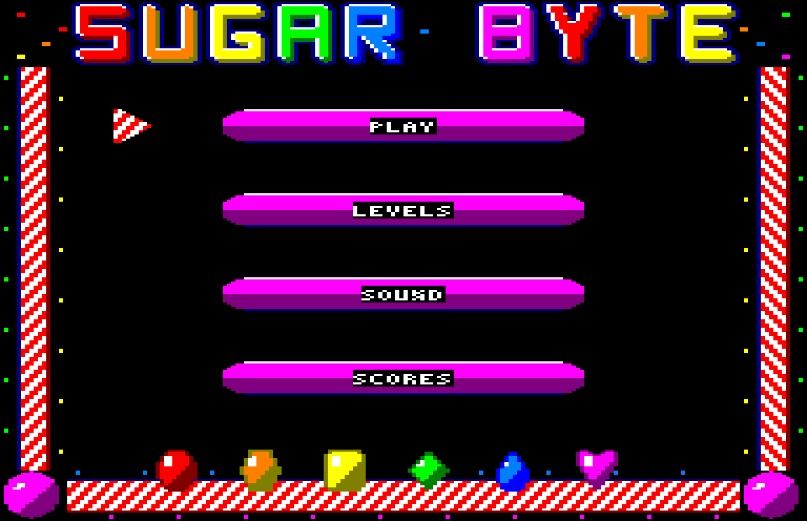
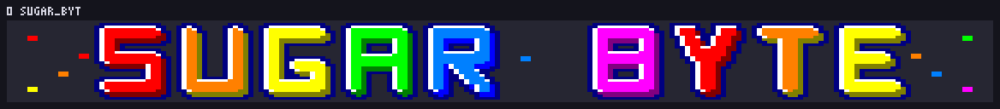
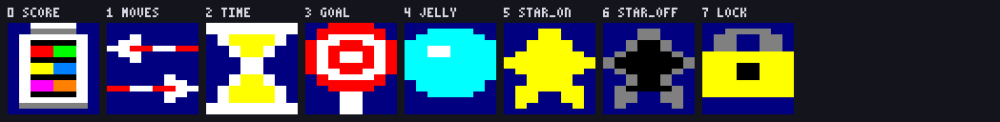
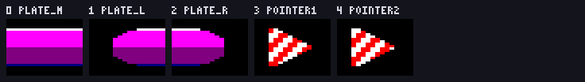

# Sugar Byte — γραφικά match-3 για Amstrad CPC Mode 0

Πλήρες γραφικό πακέτο για παιχνίδι τριάδων τύπου Candy Crush, φτιαγμένο για
**Mode 0** του Amstrad CPC: 16 pens, pixels με αναλογία 2:1, οθόνη **overscan**.

Το παιχνίδι ζει στο [SugarByteCPC](https://github.com/vaspervnp/SugarByteCPC) —
εδώ είναι μόνο η πηγή των γραφικών. Όλα παράγονται από τη γεννήτρια στο `src/`
και υπάρχουν και ως `.aseprite` για πείραγμα με το χέρι.




*Οι δύο οθόνες, 192×248 η καθεμία, σχεδιασμένες με pixels 2:1. Αυθεντικά
pixels: [`mockup_screen.png`](mockup_screen.png), [`mockup_menu.png`](mockup_menu.png).*

## Η οθόνη

**192×248 pixels** — overscan, δηλαδή η εικόνα βγαίνει έξω από το κανονικό
παράθυρο των 160×200 και πατάει πάνω στο περιθώριο.

```
y   0.. 31   ο τίτλος, 192x32
y  32..223   το παιχνίδι: 16 μπορντούρα | 160 παιχνίδι | 16 μπορντούρα
y 224..247   το πόδι, 192x24
```

Τα 192 γραμμές του παιχνιδιού είναι **ακριβώς 8 πλακάκια μπορντούρας των 24**,
και τα 160 pixels του παιχνιδιού είναι **ταμπλό 96 + HUD 64**. Τίποτα δεν
περισσεύει και τίποτα δεν λείπει· αν αλλάξει ένα από τα τρία, αλλάζουν και τα
άλλα δύο.

## Τα μεγέθη

Ένα **κελί ταμπλό** είναι **12 pixels φάρδος × 24 γραμμές** — τετράγωνο στην
οθόνη (24×24 «μονάδες»), 6 bytes τη γραμμή. Το ταμπλό είναι **8×8 κελιά**.

Ένα **κελί HUD** είναι **4×8** (8×8 μονάδες), ένα **εικονίδιο HUD** 8×16
(16×16 μονάδες), ένα **πλακάκι μπορντούρας ή μενού** 16×24 (32×24 μονάδες).

Τα candies και οι επικαλύψεις έχουν **μάσκα** (pen 0 διάφανο)· όλα τα άλλα
είναι **αδιαφανή**. Έτσι το ίδιο candy πατάει πάνω σε σκέτο κελί, σε ζελέ ή σε
σοκολάτα χωρίς αντίγραφα: αλλιώς τα 27 candies θα ήθελαν μία έκδοση για κάθε
φόντο.

## Τι περιέχει

| Αρχείο | Περιεχόμενο |
|---|---|
| `candy_cpc_mode0.*` | 27 candies 12×24 με μάσκα: 6 χρώματα × 4 μορφές, βόμβα, 2 υλικά |
| `cells_cpc_mode0.*` | 10 κελιά ταμπλό 12×24 αδιαφανή: φόντο, ζελέ, γλάσο, εμπόδια |
| `overlay_cpc_mode0.*` | 14 επικαλύψεις 12×24 με μάσκα: δείκτης, κλουβί, μαρμελάδα, εφέ |
| `hud_cpc_mode0.*` | 28 κελιά HUD 4×8: ψηφία, σύμβολα, 5 μικρά εικονίδια, πλαίσιο |
| `text_cpc_mode0.*` | 31 κελιά 4×8: κεφαλαία `A`–`Z`, χάρακας, μπάρα προόδου |
| `icons_cpc_mode0.*` | 8 εικονίδια HUD 8×16: βάζο, βέλη, κλεψύδρα, γλειφιτζούρι, ζελέ, αστέρια, λουκέτο |
| `title_cpc_mode0.*` | το λογότυπο 192×32 για την πάνω μπορντούρα |
| `border_cpc_mode0.*` | 4 πλακάκια μπορντούρας 16×24: κορδόνι ζαχαρωτού και γωνία |
| `menu_cpc_mode0.*` | 5 πλακάκια μενού 16×24: πιάτο επιλογής και δείκτης |
| `sprites.bin` / `sprites.asm` | τα **τέσσερα σετ του παιχνιδιού** σε bytes Mode 0 |
| `menu.bin` / `menu.asm` | τα **πέντε σετ του τίτλου και του μενού**, δεύτερο blob |
| `sprites_map.txt` | πού κάθεται κάθε καρέ μέσα στα δύο blobs |
| `palette.gpl` | η παλέτα για GIMP/Aseprite, με τα firmware numbers |
| `manifest.json` | σύνοψη: παλέτα, σετ, μεγέθη, διάταξη οθόνης, μνήμη |
| `mockup_screen*.png`, `mockup_menu*.png` | οι δύο πλήρεις οθόνες |
| `preview_*.png` | κατάλογοι με δείκτες, σε αναλογία 2:1 |
| `src/` | η γεννήτρια — `python3 src/make_all.py` τα ξαναφτιάχνει όλα |

## Η παλέτα


Δεκαέξι pens από τα 27 του firmware. Τα **πέντε πρώτα είναι καρφωμένα** και τα
**έντεκα υπόλοιπα κρατάνε τα έξι χρώματα των candies**, βάση + σκιά:

| | pen | FW | χρώμα | ρόλος |
|---|---|---|---|---|
| | 0 | 0 | `#000000` | φόντο ταμπλό **και** μάσκα των sprites |
| | 1 | 26 | `#FFFFFF` | ανταύγεια, ρίγες, γράμματα |
| | 2 | 13 | `#808080` | γκρι: πλέγμα, γλάσο, χρώμια |
| | 3 | 1 | `#000080` | περίγραμμα, σκιά, ταμπλό HUD |
| | 4 | 20 | `#00FFFF` | ζελέ, εφέ, τόνος UI |
| κόκκινο | 5 / 6 | 6 / 3 | `#FF0000` / `#800000` | μπαλάκι |
| πορτοκαλί | 7 / 8 | 15 / 12 | `#FF8000` / `#808000` | εξάγωνο |
| κίτρινο | 9 / 8 | 24 / 12 | `#FFFF00` / `#808000` | τετράγωνο |
| πράσινο | 10 / 11 | 18 / 9 | `#00FF00` / `#008000` | ρόμβος |
| μπλε | 12 / 13 | 11 / 2 | `#0080FF` / `#0000FF` | δάκρυ |
| μωβ | 14 / 15 | 8 / 4 | `#FF00FF` / `#800080` | καρδιά |

Το **πορτοκαλί και το κίτρινο μοιράζονται τη σκιά τους** (pen 8): δεν περίσσευε
δέκατο έκτο pen. Γι' αυτό ο κώδικας διαβάζει τον πίνακα `candy_pens` (6 ζεύγη
= 12 bytes) και δεν υπολογίζει `5 + 2 × χρώμα`.

Το pen 0 είναι **ταυτόχρονα το φόντο και η μάσκα**, και αυτό είναι επίτηδες:
ένα sprite με μάσκα πάνω στο μαύρο ταμπλό δείχνει μαύρο εκεί που είναι
διάφανο, δηλαδή ακριβώς ό,τι πρέπει. Γι' αυτό το **περίγραμμα κάθε candy δεν
είναι μαύρο αλλά η σκιά του ίδιου του candy**.

## Τα candies


Κάθε χρώμα έχει **δική του σιλουέτα**, όχι μόνο δικό του χρώμα: μπαλάκι,
εξάγωνο, τετράγωνο, ρόμβος, δάκρυ, καρδιά. Σε Mode 0 δύο διπλανά pens
μπερδεύονται εύκολα σε μικρή οθόνη ή σε ασπρόμαυρη, και το σχήμα είναι το μόνο
που κρατάει.

Τέσσερις μορφές ανά χρώμα — `plain`, `striped_h` (καθαρίζει γραμμή),
`striped_v` (καθαρίζει κολόνα), `wrapped` (σκάει 3×3) — συν τη **βόμβα
χρώματος** και δύο **υλικά**, κεράσι και φουντούκι.

Οι πέντε σιλουέτες **υπολογίζονται**· μόνο η καρδιά είναι ζωγραφισμένη, γιατί
με implicit καμπύλη οι δύο καμπούρες έβγαιναν ένα pixel η καθεμία. Το
**περιτύλιγμα είναι ένα σχήμα για όλα τα χρώματα** (όπως στο Candy Crush), με
στριφτές άκρες πάνω και κάτω: οι άκρες πάνε στον κάθετο άξονα επειδή το Mode 0
έχει διπλή ανάλυση εκεί — ίδιο μέγεθος στην οθόνη, διπλάσια pixels για να φανεί
το χωνί.

Τα ριγέ ζωγραφίζονται **χωρίς ανταύγεια**: η λευκή βούλα κολλούσε στις ρίγες
και γινόταν μπάλωμα.

## Τα κελιά του ταμπλό


Το **ζελέ σημαδεύεται στο περίγραμμα** του κελιού, όχι στο γέμισμα: το γέμισμα
το σκεπάζει το candy από πάνω και δεν θα φαινόταν ποτέ. Το **γλάσο μετριέται
και από τη φωτεινότητα και από τις ρωγμές** — μόνο οι ρωγμές ήταν πολύ λίγο σε
12×24 pixels.

Το πλέγμα μπαίνει στη **δεξιά κολόνα και στην κάτω γραμμή** κάθε κελιού, ώστε
δύο γειτονικά κελιά να δίνουν μία γραμμή και όχι δύο.

## Επικαλύψεις και εφέ


Η μαρμελάδα είναι **σκακιέρα 1 pixel × 2 γραμμές**: το Mode 0 δεν έχει
«μισό-διάφανο», και ο dither 1×2 είναι ο μόνος που δεν τρεμοπαίζει.

## Ο τίτλος και η μπορντούρα



Το λογότυπο είναι **192×32** και γεμίζει όλη την πάνω μπορντούρα. Τα γράμματα
δεν είναι ASCII art: φτιάχνονται από **μπάρες και στύλους** σε κουτί 14×26, με
ένα πέρασμα στρογγυλέματος στις γωνίες και μετά τις διαγώνιες. Κάθε γράμμα
παίρνει εξώθηση στη σκιά του, ανταύγεια πάνω-αριστερά και περίγραμμα.

Οι διαγώνιες κουβαλάνε **δικό τους πλάτος** γιατί δεν έχουν ίδια κλίση: στις 45
μοίρες το πάχος που βλέπει το μάτι είναι το οριζόντιο διά ρίζα δύο, οπότε το
πόδι του `R` θέλει 5 pixels για να φαίνεται ίσο με στύλο 3. Το πόδι τελειώνει
**ίσιο**, πάνω στη θέση του δεξιού στύλου, αλλιώς το `R` έγερνε έξω από το
πλάτος του.


Η μπορντούρα είναι **κορδόνι από ζαχαρωτό** σε πλακάκια 16×24, με ζαχαρωτά
στις δύο κάτω γωνίες. Το πλάτος της ρίγας **δεν είναι ελεύθερο**: το πλαϊνό
πλακάκι επαναλαμβάνεται κάθε 24 γραμμές (φάση +12 pixels) και το κάτω κάθε 16
pixels, οπότε για να μη φαίνεται ραφή πρέπει και το 12/ρίγα και το 16/ρίγα να
βγαίνουν **ζυγά**. Το 2 είναι η μόνη τιμή που ικανοποιεί και τα δύο.

## Το HUD και το μενού

 

Ο χωρισμός σε δύο μεγέθη είναι σκόπιμος. Τα **4×8** είναι η τυπογραφία και τα
σιδερικά — ψηφία, κεφαλαία `A`–`Z`, σύμβολα, χάρακας, μπάρα προόδου, πλαίσιο.
Τα **8×16** είναι η εικονογραφία: βάζο με καραμέλες, βέλη ανταλλαγής, κλεψύδρα,
γλειφιτζούρι, ζελέ, αστέρια, λουκέτο. Στα 4×8 (τέσσερις στήλες) ένα
γλειφιτζούρι δεν διαβάζεται με τίποτα.

Τα κεφαλαία είναι **οι ίδιες μορφές με τη γραμματοσειρά 4px του `planetbase`**:
στις τρεις στήλες το `N`, το `M` και το `W` είναι λυμένα εκεί και δοκιμασμένα,
και δύο αλφάβητα στο ίδιο repo θα ήταν δύο πράγματα να συντηρηθούν. Στοιχίζονται
στη **βάση** των ψηφίων, γι' αυτό ξεκινούν μία γραμμή πιο κάτω.



Τα κεφαλαία, ο χάρακας και η μπάρα είναι **δικό τους σετ** (`text`) και όχι
ουρά του `hud`: μπαίνουν σε άλλο blob, γιατί τα θέλει μόνο η οθόνη του μενού.

Το μενού μοιράζεται το κελί 16×24 με τη μπορντούρα: **πιάτο** σε τρία κομμάτια
(στρογγυλό αριστερά, ίσιο, στρογγυλό δεξιά) και **δείκτης** σε δύο φάσεις, με
τις ρίγες του να τρέχουν.

Οι **στόχοι της πίστας δείχνονται με τα ίδια τα candies 12×24** — δεν
χρειάζονται δικά τους εικονίδια.

## Η μορφή στη μνήμη

Γραμμικά, γραμμή-γραμμή, **όχι** στη διάταξη της μνήμης οθόνης.

Με μάσκα: `mask, data, mask, data…` ανά γραμμή. Οι σταθερές `_W` του
`sprites.asm` δίνουν bytes **ΔΕΔΟΜΕΝΩΝ** ανά γραμμή — σε sprite με μάσκα η
γραμμή πιάνει **2×** αυτό.

**`sprites.bin` — ό,τι μένει φορτωμένο όσο παίζεις:**

| σετ | κελί | καρέ | bytes/καρέ | σύνολο | offset |
|---|---|---|---|---|---|
| `candy` | 12×24 με μάσκα | 27 | 288 | 7.776 | `#0000` |
| `cells` | 12×24 αδιαφανές | 10 | 144 | 1.440 | `#1E60` |
| `overlay` | 12×24 με μάσκα | 14 | 288 | 4.032 | `#2400` |
| `hud` | 4×8 αδιαφανές | 28 | 16 | 448 | `#33C0` |
| | | **79** | | **13.696** | |

**`menu.bin` — ζωγραφίζεται μία φορά και μετά ο χώρος του ξαναχρησιμεύει:**

| σετ | κελί | καρέ | bytes/καρέ | σύνολο | offset |
|---|---|---|---|---|---|
| `text` | 4×8 αδιαφανές | 31 | 16 | 496 | `#0000` |
| `icons` | 8×16 αδιαφανές | 8 | 64 | 512 | `#01F0` |
| `title` | 192×32 αδιαφανές | 1 | 3.072 | 3.072 | `#03F0` |
| `border` | 16×24 αδιαφανές | 4 | 192 | 768 | `#0FF0` |
| `menu` | 16×24 αδιαφανές | 5 | 192 | 960 | `#12F0` |
| | | **49** | | **5.808** | |

Ο χωρισμός σε δύο blobs **δεν είναι καλλωπισμός**: στο SugarByteCPC ο χώρος
των sprites (`#4000`–`#757F`) είναι γεμάτος ώς το τελευταίο byte και υπάρχει
`assert` που το φυλάει. Το `sprites.bin` μένει έτσι **byte-προς-byte** αυτό που
έχει ήδη το παιχνίδι, και τα καινούργια γραφικά δεν σπάνε τίποτα.

Όλα τα καρέ ενός σετ έχουν ίδιο μέγεθος, άρα **δεν χρειάζεται πίνακας δεικτών**:
`διεύθυνση = <set>_gfx + καρέ × <SET>_SZ`.

Ο κωδικοποιητής Mode 0 είναι **ο ίδιος με του `planetbase`** (ελεγμένο σε 256
ζεύγη pens), και το `cpcgfx.py` κρατάει δίπλα του τον αντίστροφο με έναν
ισχυρισμό που τρέχει σε κάθε import: ο αποκωδικοποιητής γράφεται εύκολα ανάποδα
και βγάζει ψεύτικο συναγερμό σε σωστά δεδομένα.

## Ξαναχτίσιμο

```bash
python3 src/make_all.py
```

Γράφει φύλλα PNG σε αυθεντικά pixels Mode 0, πίνακες JSON, προεπισκοπήσεις 2:1,
τις δύο οθόνες, την παλέτα και το `sprites.bin` / `sprites.asm`.

Τα `.aseprite` θέλουν το Aseprite στο `$ASEPRITE`· χωρίς αυτό η γεννήτρια
αφήνει τα ενδιάμεσα dumps στο `build/aseprite/` και τα χτίζεις μετά:

```bash
aseprite -b --script-param in=build/aseprite/candy_cpc_mode0.txt \
            --script-param out=candy_cpc_mode0.aseprite \
            --script-param mode=frames --script src/make_aseprite.lua
```
